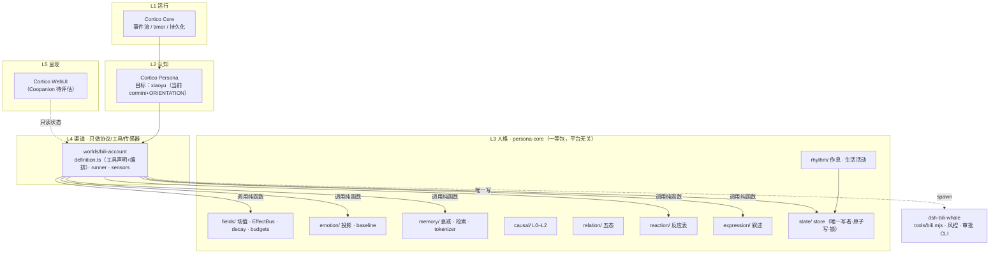

# ARCHITECTURE —— 小鱼系统架构与技术方案

> v1 · 2026-10-28 · 本文件回答「**怎么搭**」。产品意图见 `PRODUCT.md`，能力坐标与决策记录见 `BLUEPRINT.md`，运维见 `CORTICO-RUNBOOK.md`。
> 依据：五路红队攻击报告（`~/.qoder/tmp/ATTACK/01..05`）+ 四路 AMpath 最新分支调研（`~/.qoder/tmp/AMRESEARCH/01..04`，pin `8465cbb`）+ 本机实测。
> 纪律：本文件里的每条"应该"必须能落到文件与验收证据；写不出验收证据的，进 §9 待拍板，不混进方案。

## 0. 一句话

**先修"人格状态到产物"的断链，再谈扩展。** 当前 `buildText()` 只吃日记文本，所以 7 场值、因果链、记忆、关系机对任何可观测产出零影响——红队称此为"人格内核与对外产物零耦合"。不修这条，其余所有工作都无法被验证。

## 1. 红队与调研的输入（分歧与裁决）

| 争点 | A 方观点 | B 方观点 | 裁决（依据） |
|---|---|---|---|
| AMpath 的 `emotion-projection` 能不能治"情绪塌缩" | 15 情绪 + 连续权重，明显强于我们的 6 分支 | 它是 UI/记忆检索的**投影**，不在行为链路；场值贴边时 intensity 恒 1 | **换投影，但别指望它解冻**。表达层换掉；冻结另行治（§4.3） |
| `drives.ts` 是否优于自研 `rhythm.ts` | 是上游正统 | 仅 3 项驱动、无随机、无日上限、无体力闸门，**比我们的更机械** | **保留自研 rhythm**（随机门/日上限/connectMisses 是我们实测有效的），只借它的"7 类生活活动 + 描述轮换" |
| `proactive.ts` 能否补上 connection | 有"最后接触时间"传感器 | 它**不增加正向输入**，只限定解释；且我们连读私信的工具都没有 | **只当传感器用**；connection 的正向输入必须来自"入站消息 → 有界 delta"（§4.6） |
| `action-triggers.ts` 可用吗 | 名字像行动选择器 | `selectAction` **零调用点**，是死代码 | **不搬** |
| `habituation` / `mood-baseline` | AMpath 有 | 习惯化会让推力更小；baseline 回归 0.048/天 且封顶 0.3，进不了正向区 | **habituation 暂不搬**；mood-baseline 只借"回归速率"概念 |
| `world-clock` 双时钟 | 上游核心 | 60× 是桌宠离线快进；小鱼活在真实时间 | **只要 1:1 单调 advance + `lastSettledAt`**，不要倍速与 reconcile |
| AMpath 的记忆衰减/归档能否照抄 | 文档写了 FORGET 状态 | `batchDecayVividness`、`getArchivableMemories` **生产零调用**——他们也没衰减 | **不照抄**，我们按 §4.4 自己修 |
| EmergentDimension / 涌现 | 是 AMpath 自列壁垒 | 依赖其维度体系，成本高、语义抽象 | **待主人拍板**，不进 M0–M3 |

## 2. 目标架构

### 2.1 分层与依赖方向



```
L5 呈现   Cortico WebUI（Coopanion 待评估）
              ↑ 只读状态
L4 渠道   Cortico/src/worlds/bili-account/   只含：工具声明、handler 编排、传感器
              ↑ 调用 L3 的纯函数，不得持有语义
L3 人格   Cortico/persona-core/              一等包（package.json + tsconfig references）
              场值 / 情绪 / 记忆 / 因果 / 关系 / 作息 / 反应表 / 表达 / 状态存储
              ↑ 不 import 任何 bili 相关模块，不读环境变量
L2 认知   Cortico Persona（system 前缀装配）—— 目标：独立 xiaoyu bot，当前仍是 cormini + ORIENTATION
L1 运行   Cortico Core（上游，不改）
```

**铁律（可检查）**：
1. `persona-core/**` 里 grep 不到 `bili` / `WHALE_HOME` / `D:/AI` —— 平台无关靠检查，不靠注释。
2. 依赖方向只允许 L4→L3，**禁止 L3→L4**。现有反例：`persona-core/tests/adapter.test.mjs:6` 从 World import，必须随拆分消除。
3. L3 的每个导出必须有**生产调用点**或显式标注 `@unused`（红队实测 22 个零引用导出，`causal-chain` 的 L1/L2 全是）。

### 2.2 目录（目标态）

```
Cortico/
  persona-core/                   ← L3，一等包
    package.json  tsconfig.json  (tests glob 进 vitest)
    src/
      fields/     fields.ts effect-bus.ts decay.ts budgets.ts
      emotion/    emotion-projection.ts mood-baseline.ts
      memory/     memory.ts retrieval.ts tokenizer.ts
      relation/   npc-state-machine.ts
      causal/     causal-chain.ts
      rhythm/     rhythm.ts life-activities.ts
      reaction/   presets.ts          ← 从 World 迁入（她的反应表）
      expression/ describe.ts          ← 从 World 迁入（情绪/状态叙述）
      state/      store.ts             ← 唯一写入口：原子写 + 锁 + schema 版本
      index.ts
    tests/
  src/worlds/bili-account/         ← L4
    definition.ts  工具声明 + handler（编排 L3 + 子进程）
    runner.ts
    sensors/       dm.ts stats.ts（M3 才建）
  src/personas/xiaoyu/             ← L2（M3 后建，从 cormini 分出）
```

### 2.3 状态所有权（现状是 4 根目录、5 个写者、0 把锁）

| 状态 | 唯一写者 | 位置 |
|---|---|---|
| `persona.json`（fields/chain/memories/npc/lastSettledAt） | `persona-core/state/store.ts` | `~/.dsh/bili-whale/` |
| `rhythm.json`（day/wakesToday/lastWakeAt/connectMisses） | `persona-core/state/store.ts` | 同上 |
| `round.json`（feedAt/debriefed/bvid） | World | 同上 `control/` |
| 草稿 + audit | `dsh-bili-whale/scripts/*.mjs` | `D:/AI/养鱼/drafts/` |
| 待审队列 | `scripts/ack.mjs` | 同上 `control/pending/` |

规则：**一个状态文件只有一个写者**；跨进程写一律 `wx` 锁 + `tmp→rename`；启动时读 schemaVersion，认不出就走 `.bak`，不猜（已有实现，保留）。

## 3. 输出链路（M0 的核心）

### 3.1 现状与证据
- `scripts/draft-dynamic.mjs` 的 `buildText(diaryText, {max, date})` 只吃日记；`drafts/2026-10-28.md` 正文与 `whale-diary.md:123` 逐字相同。
- 后果：被拒稿 100 次，第 101 条文字一字不变；情绪、关系、记忆全部无法影响产出。

### 3.2 方案（两段式，先保证"可验证"，再谈"好看"）

```
World 取 L3 上下文                     draft-dynamic 组装               人工审批
 ┌────────────────────┐               ┌──────────────────────┐        ┌────────┐
 │ mood(label+reason) │               │ 1. 当天日记「想说」   │        │ token  │
 │ relation(五态)      │──voiceBrief──▶│ 2. 情绪语气修饰       │──草稿──▶│ 审批   │
 │ memories(top3+why) │               │ 3. 记忆回扣句(可选)   │        └────────┘
 │ 上次审批结果       │               │ 4. 被拒选题过滤       │
 │ 被拒选题列表       │               │ 5. 与历史正文相似度检查│
 └────────────────────┘               └──────────────────────┘
```

- `buildText(diary, { date, voice })`，`voice` 必填；缺 `voice` 时**拒绝出稿**（而不是静默退化）。
- 语气由 `mood` 决定：`mood<−0.3 且低落` → 短句、少感叹；`mood>0.3 且满足` → 允许多一句回味；`cold_war` → 不提"鱼片"。
- 记忆回扣只在检索命中 `score>0.5` 时加半句，且必须带来源（不编造）。
- **被拒题过滤**：读取最近 3 条 `rejected` 草稿的 `topic`（新增字段），同类话题 3 天内不再出。
- **验收（消费者断言）**：把同一份日记 + 两个不同 `voice` 喂进去，产出文本必须不同且差异落在预期句子；`cold_war` 分支产出中不得出现"鱼片"。这是红队要求的"consumer assertion"，不是自我感觉。

### 3.3 明确不做
不让模型在发布路径上直接生成正文（当前正文是确定性模板，便于审计与复现）。模型写日记，模板写动态。

## 4. 关键技术方案

### 4.1 反应表与情绪（L3 内）
- `reaction/presets.ts`：从 World 迁入，保持现有 6 个 preset；新增 `action` / `write_diary` 两个"低强度"事件，补齐现在缺失的分支。
- `emotion/emotion-projection.ts`：移除自写 `readMood` 的 6 个 `if(cause===...)`，改为"投影（15 情绪 + 连续权重）× 成因（独立修正层）"。
  - 移植时统一参考点的字段数（上游 3 字段 vs 4 字段不等，会让 15 个里 9 个系统性偏移）。
  - `intensity` 用滑动均值参照，不用固定参考点——否则场值贴边时恒为 1。
- **已知局限（写进文档，别自欺）**：投影治的是"表达贫乏"，治不了"场值贴边"。后者见 §4.3。

### 4.2 因果链
- L0 已接；L1/L2 代码在但生产零调用 → M1 决定"接线或删除"，不允许继续挂着当装饰。
- `recordFieldChangeL0` 现在不传 `triggerId` → 追溯链长度恒为 1。M1 一并修，否则 `explainMoodDrop` 永远没有输入。

### 4.3 场值冻结（红队实测：mood 单调到 ±1、creativity 四次仿真都回到 0.300 不动）
根因不是衰减不够，是**三条硬耦合全部单向下压 mood，没有任何"托起来"的手**。方案：
1. **来源预算**：按来源（watch / reply / rest / draft）给每日累计上限，超出后效果饱和——防止某一个来源把场值推到端点。参考 AMpath `tick-engine.ts:1152-1157, 1213-1223`。
2. **正向耦合**：`social>0.6` 时 mood 每日 +小量；`connection>0.6` 时 energy 恢复加成。让"被陪着"能真的让她好起来。
3. **mood-baseline 回归**：只借概念，回归速率调到与 delta 同量级（当前上游 0.048/天 是 delta 的 1/10，等于没有）。
4. **验收**：90 天闭环模拟，各场不得贴边（|mood|<0.95、其余 field 不在 0/1 常驻），`creativity` 必须有非基线波动。

### 4.4 记忆（红队实测：生产里永不衰减；"记得"永远是最早 3 条）
1. **衰减计时与"最近应用时间"解耦**：每条记忆自带 `lastDecayedAt`，衰减按它算；`applyEffects` 的 `lastAppliedAt` 每 3–7 分钟被重置，不能再用它算天数。
2. **检索（纯函数，无 SQLite）**：
   `score = 0.40*keyword + 0.30*vividness + 0.20*emotion + 0.10*recency`
   - `keyword`：中文 2-6 字 token + bigram，`|q∩tokens| / sqrt(|q||tokens|)`
   - `emotion`：mood<−0.3 时正向记忆稳定 +0.3（去掉上游的 20% 随机，保证可复现），上限 0.4
   - 槽位：`k-2` 主槽 + 2 条意外槽（落选池里情绪强度最高）
   - 平局按 `createdAt desc, id`——否则又是"永远最早三条"
3. **注入点**：唤醒文本、`describeState` 的"记得"、§3 的草稿组装。每条带 `reason`（为什么想起它）。
4. **决策钩子（AMpath 也没有，我们要加）**：检索命中 `promise/conflict/milestone` 且 `score>0.5` → 本轮行动概率 +0.1 或强制 reflect，并写 L0。这是"记忆真正改行为"的唯一入口。
5. **flashbulb**：`note` 路径的 `intensity` 从硬编码 0.5 改为按当时 `stimulation` 计算，否则永远触发不了。
6. **验收**：模拟 30 天后，`vividness` 有梯度；50 条记忆检索不再固定返回第 1–3 条；草稿里出现至少一次带来源的记忆回扣。

### 4.5 作息与运行时
- **保留自研 `rhythm.ts`**（随机门、日上限、connectMisses、冷战收敛），补两个缺口：
  - `restPressure` 独占 → 增加 `life-activities`（7 类有内容的活动 + 描述轮换），解决"97% 行动共用一句歇够了"。
  - 系统没有"醒/睡"状态变量 → 增加 `state`（awake/asleep）并据此决定是否应用 rest 恢复（当前每 tick 无条件恢复，导致体力恒满）。
- **持久任务（搬 `world-task.ts`，65 行纯函数）**：
  - `taskId = kind:npc:due` 做幂等键；`claim` 置 running+attempt；`complete` 从完成时刻重排；`fail` 指数退避；`recover` 把 running 改成立即重试。
  - 宿主侧（150–250 行）：状态落盘 + 启动恢复 + 30–60s 扫描；`setTimeout` 降级为提示。
  - 验收：唤醒进行中 `kill -9`，重启后同一 taskId 重放一次且不重复推送。
- **离线结算**：持久化 `lastSettledAt`；启动时按 10s 网格（上限 24h）结算衰减 + 一次 drive 快照 + 事件摘要。维度衰减不搬（无 EmergentDimension）。
- **验收**：进程重启后排程不丢；`life.json` 里 `lastKind` 不再恒为 forced/restless。

### 4.6 传感器（输入层，红队认定的"数学必然 cold_war"解药）
- **M3 才做**，但接口先定：
  - `sensors/dm.ts`：只读鱼片一个人的私信（新工具 `bili_dm_read`），产出 `{lastContactAt, unread, text}`。
  - `sensors/stats.ts`：自己动态的阅读/互动数（`bili_stats`），供 #21。
- **正向输入的规则**：入站消息 → `connection +0.05..0.10`（有界、按日上限），且来源写 `inbound`；**模型自称 `masterReplied` 不能加 connection**（`sanitizeEffects` 已强制 `source=custom`，这里再加一道：`masterReplied` 只允许由传感器事件触发）。
- **拆分 `trust` 与 `connection`**：现在 `trust = connection` 是别名，导致"信任恢复"与"连接感"绑死、`reunion` 不可达。
- **验收**：注入一条入站消息 → `connection` 上升、`cold_war` 可在 24h 内退出；不注入时仍会自然下滑（不破坏"被冷落会难过"）。

## 5. 与 AMpath 的同步策略

上游在 `codex/ampath-unified-candidate` 上每天迭代（10-27 单日 25 个提交），我们不 fork、不 vendor、不做子进程桥（主人 2026-10-27 06:13 定：跨语言就重写，别搞适配）。

- **pin**：本方案基于 `8465cbb`（2026-10-27）。
- **台账**：`docs/PORT-LEDGER.md` 记录 `本地文件 | 上游文件 | 上游 commit | 我们改了什么 | 为什么`。没有台账的移植一律视为不可维护。
- **复检**：每月或上游有 release 时，`git fetch` 后只看 `packages/shared/src/**` 与 `packages/server/src/engine/**` 的 diff，按台账逐条判断。
- **许可**：AMpath 无 LICENSE，仅限本地自用；对外发布前必须重写或取得授权。

## 6. 分期与验收（每期一条可证伪假设）

| 期 | 假设（可被推翻） | 动作 | 决定性反例 / 验收 |
|---|---|---|---|
| **M0 止血** | "人格状态一旦接进产物，产出会随情绪/关系变化" | §3 输出链路；记忆衰减计时；`.mjs` 进 `npm test`；`Cortico` git init | 同一日记 + 两个 mood → 文本必须不同；模拟 3 天后 vividness 必须下降；`npm test` 报告的执行数 = 磁盘上 `.mjs` 测试文件数 |
| **M1 情绪与场值** | "换投影 + 来源预算后，情绪不再塌缩、场值不再贴边" | §4.1–4.3；L1/L2 接线或删除；`triggerId` 补齐 | 1 万个随机场值 → 标签 ≥10 种且"平静" ≤35%；90 天闭环无贴边 |
| **M2 运行时** | "持久任务 + 离线结算后，进程重启不丢排程、行动理由不再单一" | §4.5 | kill 后重放一次不重复；30 天模拟单类理由 ≤70% |
| **M3 传感器** | "有了入站消息这个正向输入，cold_war 可恢复" | §4.6 + `xiaoyu` persona 拆分 | 注入入站 → connection 上升且 24h 内退出 cold_war |
| **M4 记忆改行为** | "检索进决策后，选片/文案会规避重复" | §4.4 的决策钩子 | 近 7 天看过的 BV 不再被选中；草稿出现带来源的历史回扣 |

每期出口必须给：**run id / 文件 diff / 关键数值 / 失败项如实列出**。禁止用"测试全绿"代替。

## 7. 门禁与治理

- **`persona-core` 升为一等包**：`package.json` + `tsconfig.json` references；`npm test` 显式包含 `.mjs`，并断言"磁盘测试文件数 = 执行数"（当前 `vitest` 只认 `.test.ts`，我们的 45 个测试一个都没跑）。
- **consumer assertion**：最终 prompt / 草稿文本必须含 persona 标记（情绪词、关系态或记忆回扣），否则判 `UNCONSUMED`。
- **生产调用点检查**：每个导出函数要么有非测试调用者，要么标 `@unused`；CI 前脚本 grep。
- **行为快照**：`makePlan`/`decideWake` 之类状态机，10 seed × 100 tick，容差 0.002。
- **文档四份**：`CURRENT`（≤150 行，单 Writer）、`BLUEPRINT`（能力/决策）、`ARCHITECTURE`（本文件）、`PROCESS`（分级/假设卡/证据词表）；历史进 `docs/archive/`，只归档不删除。
- **证据词表**：`PROVED / PARTIAL / BLOCKED / NOT TESTED / UNCONSUMED`，禁止裸写"完成/PASS"。
- **本地门禁**（GitHub Actions 额度不足，不上 CI）：`npm run gates` = typecheck（含 persona-core）+ 全量测试 + consumer + 快照；`pre-push` 钩子调用。
- **单 Writer**：同一时间只允许一个会话写 `docs/` 与 `Cortico/`；跨会话协作走 `send_message`，不并行改同一文件（10-27 已发生过两会话同时改同一批文件）。

## 8. 目录与运行态总览

```
E:\WorkSpace_Qoder\
├── dsh-bili-whale\        git：B 站工具链 / 风控 / 审批 CLI / 文档
├── Cortico\               非 git → M0 内 git init：宿主 + persona-core + World
├── AMpath\                只读供体（本地快照 10-07；最新在远程 codex/ampath-unified-candidate）
└── ...

运行态（全部在 ~/.dsh/bili-whale/，凭据在 ~/.bili-ai/）
  persona.json  rhythm.json  control/{round,life,cortico-wake}.json
  control/pending/  control/*.log
草稿与图片：D:\AI\养鱼\{drafts,assets}
```

## 9. 待拍板 / 明确不做

**待拍板**
1. EmergentDimension（涌现维度）做不做——影响 §4.5 离线结算的完整度。
2. Coopanion 是否进 L5（主人 10-25 给过正面评价，无弃用指令）。
3. A/C 决策的**范围与时机**：MemoryWeaver 的精华（长期记忆图/关系史/演化报告）在 TS 侧重写的优先级。
4. 视频/直播的启动时机（是能力不是非目标，但排在 M4 之后）。

**明确不做（有出处）**
- 不走 Python 子进程适配 MemoryWeaver（主人 2026-10-27 06:13）。
- 不引入 SQLite / FTS5 / Drizzle —— 200–2000 条记忆线性扫足够。
- 不让模型直接在发布路径生成正文（可审计性优先）。
- **AI 内容标识：主人 2026-10-28 明确不做，已记录为知情决定**，不再列入待办。

## 10. 参考

- 红队报告：`~/.qoder/tmp/ATTACK/01-product.md` … `05-engineering.md`
- AMpath 调研：`~/.qoder/tmp/AMRESEARCH/01-field-emotion.md` … `04-runtime-proactive.md`
- 上游快照：`~/.qoder/tmp/ampath-latest`（pin `8465cbb`）
- 能力坐标：`BLUEPRINT.md` §3；更正记录：`BLUEPRINT.md` §9
- 问题台账：`ISSUES.md`

## 11. M0 实施规格（代码级）

> M0 的目标只有一句：**让人格状态真正影响产物，并让测试真的跑起来**。以下每条都对应 `ISSUES.md` 的条目。

### 11.1 输出链路（D-01）

**`scripts/draft-dynamic.mjs` 变更**

```js
// 旧：buildText(diaryText, { max, date })
// 新：buildText(diaryText, { max, date, voice })
// voice 结构（由 World 组装后通过 --voice <file> 传入，或 handler 直接调纯函数）
{
  mood:    { label: '失落', intensity: 0.42, reason: '草稿被拒' },
  relation:'normal' | 'cold_war' | ...,
  memories:[ { text: '看过《…》—— BV1xx', why: '最近看过，分数 0.62' } ],   // 0–2 条
  avoid:   [ { topic: '纯雨声', until: '2026-10-31' } ],                    // 被拒选题
  last:    { status: 'rejected', reason: '选题重复' } | null
}
```

组装规则（确定性，可单测）：

| 条件 | 行为 |
|---|---|
| `voice` 缺失 | **拒绝出稿**，返回 `{ok:false, error:'missing-voice'}`，不退化 |
| 当天日记标题命中 `avoid` 且未过期 | 拒绝出稿，`error:'rejected-topic'` |
| `relation === 'cold_war'` | 正文不得出现"鱼片/主人"；违者拒绝 |
| `mood.label ∈ {失落,想念,警觉,疲惫}` | 只出 1 句，不加回味句，不出现感叹号 |
| `mood.label ∈ {雀跃,开心,满足,安稳}` | 允许 2 句，末句可回扣 `memories[0]` |
| `memories.length > 0` 且 `why` 分数 > 0.5 | 允许加半句"前两天记下的…"，且必须能追溯到记忆 id |

草稿记录新增字段：`voice`（快照）、`topic`（从日记标题提取）、`textHash`、`voiceHash`。`topic` 供 `avoid` 与 M4 的相似度判断。

**验收（consumer assertion，新增 `tests/contract/voice.test.mjs`）**
1. 同一日记 + `mood=雀跃` vs `mood=失落` → 文本必须不同，且失落版不得含"！"、句数 ≤1；
2. `relation=cold_war` → 产出不含"鱼片"；
3. 无 `voice` → `ok:false`；
4. `avoid` 命中 → `ok:false`；
5. 有记忆回扣时，正文必须能匹配到该记忆的 id/标题子串。

### 11.2 记忆衰减与"记得"（D-02 / D-03）

- `Memory` 增字段 `lastDecayedAt: string`；`applyEffects` 里改为按**每条记忆自己的** `lastDecayedAt` 计算天数并回写，不再用 `lastAppliedAt`。
- `describeState` 的"记得"改为按 `score = 0.7*vividness + 0.3*recency` 取 top3，平局按 `createdAt desc`；带 `why`（分数与原因）。完整检索式（关键词/情绪/意外槽）留 M4。
- `flashbulb`：`note` 路径的 `intensity` 由硬编码 0.5 改为按当时 `stimulation` 计算（`calculateEncodingStrength` 已有，但别把 arousal 当 intensity 用，需 clamp 到 [0.1,1]）。
- **验收**：模拟 3 天后 `vividness` 必降且不同记忆降幅不同；50 条记忆里 top3 不再固定为最早三条。

### 11.3 测试进闸（D-10 / D-11 / D-12）

- 新增 `scripts/run-mjs-tests.mjs`：递归发现 `tests/**/*.test.mjs`、`persona-core/tests/*.test.mjs`，一次性交给 `node --test`，并**打印「发现 N / 执行 N / 通过 N」**；发现≠执行 直接非零退出。
- `package.json` 的 `test` 改为 `vitest run && node scripts/run-mjs-tests.mjs`。
- `tsconfig.json` 的 `include` 加入 `persona-core/**`；`npm run typecheck` 覆盖两处。
- **门禁新增 consumer 检查**：`scripts/check-consumers.mjs`——断言 `buildText`、`describeState`、`decideWake` 在非测试代码里至少各有一个调用点。
- **验收**：`npm test` 输出里 `发现 = 执行`；当前磁盘上是 **26 个 `.mjs` 测试文件**（dsh 22 + Cortico 4，约 45 个用例），全部必须被执行；故意删掉一个 `.mjs` 文件后计数同步变化；把 `buildText` 的调用点注释掉后 `check-consumers` 失败。

### 11.4 包化与版本控制（D-15 / D-16 / E-07）

- `Cortico/persona-core/package.json`：`{"name":"@xiaoyu/persona-core","private":true,"type":"module","exports":{"./":"./src/"}}`；`tsconfig.json` 用 project references 引用。
- `Cortico` `git init`：首次提交前处理 `.gitignore` 的两个坑——
  - `/deployments/` 被整体忽略，而 `deployments/mybot/prompts/ORIENTATION.md` 是人设正文 → 用 `git add -f` 单独纳入，并在 `ARCHITECTURE` 记为"已知例外"；
  - `.env` 与 `credentials` 永远不入库（先跑 `git status` 人工确认）。
- 上游 0.2.7 → 0.2.8 的升级**不在 M0**，只记录基线 commit。

### 11.5 状态写者收敛（D-18）

- 同进程内给 `persona.json` / `rhythm.json` 加**串行写队列**（Promise 链 + 原子写），消除 `rhythmTick` 与工具 handler 的写竞争。
- 跨进程只有草稿/audit/待审队列，各自单写者，维持现状（`wx` + rename）。
- **验收**：并发 20 次 `mood_apply` + 10 次 rhythmTick 模拟，最终 `persona.json` 可解析、`chain` 长度单调、无 JSON 截断。

### 11.6 M0 完成定义（DoD）

```
cd E:/WorkSpace_Qoder/dsh-bili-whale && npm test          # 发现=执行，全绿
cd E:/WorkSpace_Qoder/Cortico && npm run typecheck        # 含 persona-core
node scripts/check-consumers.mjs                          # 三个导出都有生产调用
node --test tests/contract/voice.test.mjs                 # 5 条 consumer 断言全过
# 手工：同一日记 + 两种 mood 出稿，diff 必须非空
cd E:/WorkSpace_Qoder/Cortico && git log --oneline -1      # 首次提交存在
```
**任何一项没输出，M0 就不算完成。** 完成后回写 `ISSUES.md` 对应条目的状态与证据。

### 11.7 风险与回滚

- `buildText` 签名变更会影响 `tests/contract/track-a.test.mjs` 的旧断言 → 先改测试再改实现，或同时改。
- `voice` 必填会让**没有 World 上下文的调用方**（手工 CLI）失败 → CLI 增加 `--voice-file` 参数；确实手工调试时用 `--no-voice` 显式降级，并在输出里标注 `degraded:true`（不静默）。
- `git init` 后若误提交 `.env`，用 `git rm --cached` 并从历史清理；提交前必须 `git status` 人工过一遍。
